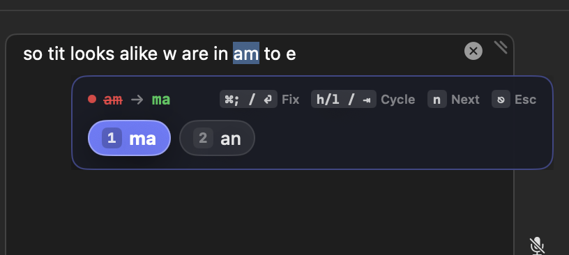

# SpellBar

A lightweight macOS menu-bar utility that brings zero-mouse, keyboard-driven spell checking and typo replacement to Chrome, Electron apps, and native macOS text fields.



---

## The Problem

In web browsers like Chrome, fixing a red-squiggly typo forces you to stop typing, take your hands off the keyboard, reach for the mouse, right-click the word, aim at a menu item, and return to the home row. Meanwhile, turning on system-wide auto-correct mangles technical terms, CLI flags, code snippets, and variable names while you type.

**SpellBar** solves this by unifying on-demand, keyboard-first typo correction under macOS's standard **`⌘;`** spellcheck shortcut.

---

## Workflows & Keyboard Navigation

SpellBar lives in the background with zero idle overhead. When you press **`⌘;`**, it instantly locates the nearest red-squiggly word (or the word at your caret), floats a clean suggestion pill directly beneath it, and pre-highlights the **#1 best guess**:

| Shortcut | Action | Description |
| :--- | :--- | :--- |
| **`⌘;`** *(1st press)* | **Inspect & Suggest** | Highlights the typo and opens the floating suggestion pill. |
| **`⌘;`** *(2nd press)* or **`Return`** | **Instant Best Guess** | Replaces the word with the pre-highlighted suggestion. Hold `⌘` and double-tap `;` (`⌘;` → `;`) for rapid one-handed correction. |
| **`h` / `l`** or **`j` / `k`** | **Home-Row Vim Cycle** | Steps the highlight left or right across suggestions without leaving the home row. |
| **`Tab`** / **`Shift + Tab`** | **Cycle Suggestions** | Steps the highlight forward or backward through available suggestions. |
| **`1` – `5`** | **Direct Pick** | Instantly commits suggestion `#1` through `#5`. |
| **`n`** or **`⌘'`** | **Next Error** | Skips the current word, jumps to the **next** red-squiggly typo in the field, and updates suggestions in place. |
| **`Esc`** | **Dismiss** | Closes the floating bar, collapses the text selection to the right edge, and resumes normal typing. |
| **`⌘⇧;`** | **Batch Auto-Fix** | Scans the active field and auto-replaces all safe, unambiguous high-confidence typos in a single keystroke, displaying a brief summary toast with a `⌘Z Undo` hint. Ignores code, camelCase, flags, and ambiguous ties. |

---

## Supported Applications

SpellBar works across any active macOS application with Accessibility trust:

- **Web Browsers**: Google Chrome, Brave, Arc, Microsoft Edge, Safari
- **Electron Apps**: Slack, Discord, Notion, Linear, VS Code
- **Native macOS Apps**: Mail, Notes, Messages, TextEdit, Pages, and standard AppKit/SwiftUI inputs

---

## Google Workspace / Gmail Setup

Gmail uses its own in-page JavaScript spellchecker that can compete with native macOS spellchecking. To let SpellBar handle spelling while keeping Google's AI autocomplete active:

1. In Gmail, click **Settings ⚙️ → See all settings → General**.
2. Set **Spelling**: `Spelling suggestions off`.
3. Keep **Smart Compose**: `Writing suggestions on` *(retains all grey inline AI ghost-text completions via `Tab`)*.
4. Keep **Grammar**: `Grammar suggestions on` *(optional, retains blue grammar underlines)*.
5. Click **Save Changes**.

Google's AI predictive drafting continues working via `Tab`, while SpellBar handles instant `⌘;` typo correction cleanly without competing popups.

---

## Architecture & Performance

- **Zero Typing Latency**: Unlike many accessibility tools, SpellBar has **zero global keystroke taps** while idle. It registers standard passive Carbon hotkeys with WindowServer, sleeping at `0.0%` CPU until invoked.
- **No Screen-Reader Lag**: SpellBar never sets `AXEnhancedUserInterface = true`, avoiding the heavy DOM synchronization that causes browser compose inputs to stutter.
- **Accurate Screen Anchoring**: In web fields where standard range bounds return `(0, 0)`, SpellBar queries WebKit/Blink's `AXSelectedTextMarkerRange` → `AXBoundsForTextMarkerRange` to position the floating pill directly below the highlighted word.
- **Clipboard Preservation**: Replacements use an atomic pasteboard snapshot and restore pass, ensuring your existing clipboard history remains untouched.

---

## Building from Source

### Prerequisites
- macOS 14.0+ (Sonoma or Sequoia)
- Xcode 15+ / Swift 5.9+ Command Line Tools
- Make

### Build & Deploy
```bash
# Run unit test suite
make test

# Compile release build, create app bundle, codesign, and deploy to /Applications
make deploy
```

`make deploy` will:
1. Build the release binary via Swift Package Manager.
2. Generate high-resolution multi-size app icons (`AppIcon.icns`).
3. Sign the application bundle (automatically using your Apple Developer ID certificate if present in Keychain, or falling back to ad-hoc).
4. Install to `/Applications/SpellBar.app` and launch it in the menu bar.

---

## Launch at Login

Click the **SpellBar** menu bar icon (`Abc` with dotted underline) and check **Launch at Login** to install a user LaunchAgent (`~/Library/LaunchAgents/com.msjurset.SpellBar.plist`).

---

## License

MIT License — Copyright (c) 2026 Mark Sjurseth. See [LICENSE](LICENSE) for details.
